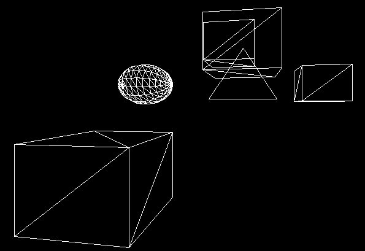
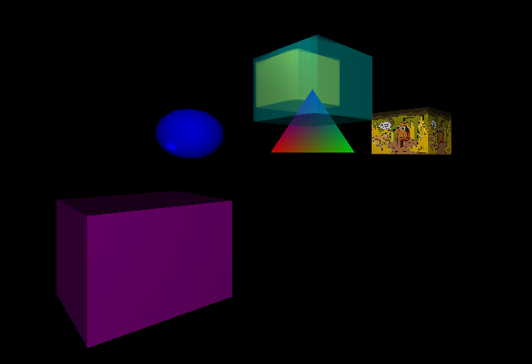

# Software Rasterizer

A 3D software renderer built from scratch in C++, developed as a 1st-year school project by a team of 2 students. The entire graphics pipeline runs on the CPU: no OpenGL, no GLM, only the C++ standard library.

---

## Table of Contents

- [Overview](#overview)
- [Screenshots](#screenshots)
- [Core Features](#core-features)
- [Rendering Pipeline](#rendering-pipeline)
- [Controls](#controls)
- [Architecture](#architecture)
- [Implementation Highlights](#implementation-highlights)
- [Tech Stack](#tech-stack)
- [Custom Libraries](#custom-libraries)
- [Build](#build)

---

## Overview

This project reimplements, in software, everything that a graphics API such as OpenGL or DirectX normally does on the GPU: vertex transformation, clipping, rasterization, shading, depth testing and blending. The goal was to understand how those APIs work internally by coding them ourselves.

[Raylib](https://www.raylib.com/) is only used to open a window and push our framebuffer to the screen as an image. Its renderer is deliberately never used.

## Screenshots

*Wireframe rendering*



*Lit and textured scene with transparency*



## Core Features

- **Triangle rasterization** using barycentric coordinates, with interpolation of color, position, normal and UV
- **Z-buffer** for correct hidden-surface removal
- **Lighting**
  - Blinn-Phong reflection model
  - Phong shading (per-pixel)
  - Point lights with ambient, diffuse and specular components
- **Texturing** from PNG files, with nearest-neighbor then bilinear filtering
- **Perspective and orthographic projection**, window with live projection update
- **Clipping** in clip space with Sutherland-Hodgman, plus line clipping (Cohen-Sutherland / Cyrus-Beck) for wireframe mode
- **Wireframe mode**, toggleable at runtime
- **Alpha blending** with a per-entity transparency value
- **Back-face culling**
- **Free camera**

## Rendering Pipeline

```
Vertex -> Model -> View -> Projection (clip space)
       -> Sutherland-Hodgman clipping
       -> Perspective divide (NDC)
       -> Viewport transform (pixel coordinates)
       -> Back-face culling
       -> Triangle rasterization (barycentric coordinates)
       -> Z-test -> Shading / texturing -> Alpha blending
       -> Framebuffer (Texture) -> Raylib Image -> Screen
```

## Controls

| Key | Action |
|---|---|
| `W` / `S` | Move the camera front/back |
| `A` / `D` | Move the camera left/right |
| `Q` / `E` | Move the camera up/down |
| `F1` | Toggle wireframe mode |
| `Esc` | Quit |

## Architecture

| Class | Role |
|---|---|
| `Vertex` | Position, color, normal and texture coordinates |
| `Mesh` | Vertex buffer and index buffer (never modified at runtime), optional texture, factory functions such as `CreateCube()` |
| `Entity` | Instance of a mesh with a transform (`Matrix4`) and an alpha value; several entities can share the same mesh |
| `Scene` | Owns entities, meshes and lights, and releases them on destruction |
| `Light` | Point light with ambient, diffuse and specular components |
| `Color` | RGBA, one `unsigned char` per channel |
| `Texture` | Image buffer, used both as render target and as sampled texture |
| `Rasterizer` | The rendering pipeline: `RenderScene(scene, target, projection, view)` |

Objects are moved by changing the entity's transformation matrix, never by editing the mesh vertices.

## Implementation Highlights

- **Software pipeline end to end** - MVP transform, clipping, perspective division, viewport mapping and rasterization all written by hand
- **Mesh sharing** - entities reference meshes by pointer, so duplicating an object never duplicates its vertex or index buffers
- **Per-pixel lighting** - interpolated position and (re-normalized) normal are used to evaluate Blinn-Phong for every pixel
- **Ordered transparency** - opaque entities are rendered before transparent ones so alpha blending composes correctly

## Tech Stack

Written in C++ on Windows, using:

| Purpose | Library |
|---|---|
| Windowing & displaying the framebuffer | [Raylib](https://www.raylib.com/) |
| PNG loading | [stb_image](https://github.com/nothings/stb) |
| Math | LibMath (custom, in-house) |

Everything else (the whole rendering pipeline) is written from scratch.

## Custom Libraries

- **LibMath** - our own math library (`Vector2/3/4`, `Matrix4`, transforms, matrix inverse, perspective projection), developed as a separate school project and reused here

## Build

The project uses **CMake**.

### Requirements

- Windows
- [CMake](https://cmake.org/) 3.30 or newer
- A C++17 compiler (Visual Studio 2022 / MSVC recommended)
- [Raylib](https://www.raylib.com/)

### Configure and build
 
```bash
git clone https://github.com/Potatoes251/Rasterizer.git
cd Rasterizer
 
cmake -S . -B build
cmake --build build --config Release
```
 
To generate a Visual Studio solution and work from the IDE, open the generated `.sln` inside `build/` after the configure step.
 
### Notes
- The project compiles without warnings and runs in both Debug and Release.
- Build outputs (`build/`, `.exe`, `.obj`, `.vs/`) are excluded from the repository via `.gitignore`.
